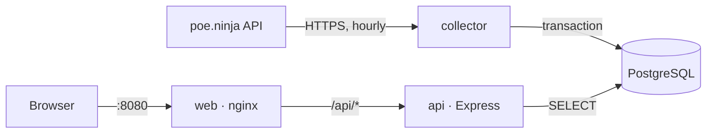

# PoE2 Farm Tracker

A learning project for tracking farming runs in Path of Exile 2: record loot and run durations, and compare farming results by value per hour.

It started as a frontend-only React app with bundled price snapshots and is being rebuilt step by step into a small full-stack system: an Express API, a PostgreSQL database in Docker, and a collector that fetches prices from poe.ninja on a schedule.

## Project status

| Stage | Status |
| --- | --- |
| React frontend: sessions, runs, loot value, localStorage | ✅ working, with [known issues](#known-issues) |
| Express API serving prices (`/api/prices`, `/health`) | ✅ done — currently reads local JSON snapshots |
| PostgreSQL in Docker with a schema created on first start (`db/init.sql`) | ✅ done |
| Collector: fetch prices from poe.ninja and store price history in the database | 🔄 in progress |
| API reads from the database, frontend fetches prices from the API | ⏳ planned |
| Whole system started with one `docker compose up` (nginx, API, collector, database) | ⏳ planned |
| Deployment to a VPS: SSH hardening, firewall, reverse proxy, HTTPS, backups, CI/CD | ⏳ planned |

## Live demo

[Open PoE2 Farm Tracker](https://lysar.poe2tracker.workers.dev/)

The demo runs the **current frontend** without the backend: price data is bundled into the app as JSON snapshots. It contains the issues listed under [Known issues](#known-issues). The backend (API, database, collector) is not deployed yet.

No account is required. Farming data is stored locally in your browser.

## Architecture

### Target



- **collector** fetches all categories from poe.ninja about once an hour and writes one snapshot per run in a single transaction.
- **db** stores items and the full price history per league.
- **api** returns the latest price of every item for a league.
- **web** (nginx) serves the built React app and proxies `/api` to the API. It is the only service exposed to the outside.

### Current

The React app and the Express API run locally side by side. The API serves prices from local JSON snapshots; PostgreSQL runs in Docker with the schema in place, ready for the collector.

## Features

- Create, select, and delete farming sessions.
- Browse items by category and search by name.
- Select tracked items and enter their quantities for each run, including negative quantities for losses or adjustments.
- Enter run durations manually.
- Calculate total loot value in Divine Orbs using price data from poe.ninja.
- Display total run time, loot value per hour, and maps per hour.
- Save and delete individual runs; browse collapsible run groups with aggregated loot summaries.
- Keep sessions and runs between page reloads using localStorage.
- Set custom prices for items.
- Load a sample farming session with the **Demo data** button.

`Profit` and `Profit per hour` currently show loot value **before expenses**. The expense section is already visible in the interface, but it is not connected to the calculations yet.

## Running locally

Requirements: Node.js 22.12 or later, npm, and Docker Desktop (for the database).

### Frontend

```
cd my-react-app
npm install
npm run dev
```

Open the local URL shown in the terminal. Click **Demo data** to explore a sample session, or create your own session to start recording runs.

### API

```
cd server
npm install
npm run dev
```

The server listens on `http://localhost:3000`:

| Endpoint | Response |
| --- | --- |
| `GET /health` | `{ "ok": true }` |
| `GET /api/prices` | all items with their current price: `id`, `name`, `category`, `image`, `price` |

### Database

From the repository root (Windows `cmd`):

```
docker run -d --name poe-db -e POSTGRES_PASSWORD=dev -e POSTGRES_DB=poe -p 5432:5432 -v poe-data:/var/lib/postgresql/data -v "%cd%\db\init.sql:/docker-entrypoint-initdb.d/init.sql:ro" postgres:16
```

On the first start with an empty volume, PostgreSQL runs `db/init.sql` and creates the tables. The password `dev` is for local development only.

## Data model

Defined in [`db/init.sql`](db/init.sql):

- **items** — one row per item. The primary key is the item id from poe.ninja, which is already stable and unique.
- **prices** — one row per item, league, and snapshot time. The league belongs to the price, not to the item: the same item has a different price in every league.
- An index on `(league, item_id, fetched_at DESC)` supports the main query: the latest price of every item in a league.

## Data storage (frontend)

Sessions and saved runs are stored in localStorage for the current browser and site address:

- Data does not sync between browsers or devices.
- Clearing site data removes saved sessions.
- Opening the app on another address starts with separate storage.

There are no user accounts or cloud backups yet.

## Price data

Currently, prices come from 14 JSON snapshots downloaded from the poe.ninja economy API with `update-poe2-api.bat` (Windows, requires `curl.exe`, saves to `src/ApiDataBase`). Check the `LEAGUE` setting in the script before running it.

Saved runs store item quantities only, so updating prices changes the displayed value of earlier runs.

The collector will replace the manual script: it will fetch prices on a schedule and keep the price history in the database. PoE 2 economy data refreshes roughly hourly, so the collector polls no more often than that and follows the [poe.ninja API usage guidelines](https://poe.ninja/docs/api).

## Known issues

The frontend works for the main flow, but has known problems that are not fixed yet:

- **Expense counter does not work yet.** Expenses for waystones, tablets, and omens can be entered in the interface, but they are not counted, so profit is still shown before expenses. The calculation logic is not written yet.
- **Item images load slowly in drag-and-drop.** When dragging items, their images can take noticeably long to appear, especially the first time an item is shown.

## Troubleshooting log

Problems I ran into while building this, and how I found the cause.

| Symptom | Cause | Fix |
| --- | --- | --- |
| Node fails with `ERR_IMPORT_ATTRIBUTE_MISSING` when importing a JSON file | Node's ES modules need an explicit `with { type: "json" }`; Vite in the frontend hides this requirement | read the files with `fs` instead, which also removed 15 repeated imports |
| `ReferenceError: Abyss is not defined` although `Abyss.json` exists | the variable was still used after its `import` had been removed — a missing name, not a missing file | removed the leftover object and loaded files from a list of names |
| Only one of two tables was created on the first database start | the foreign key referenced a column without a `UNIQUE` constraint; the init script stops at the first error and never runs again on a non-empty volume | found the `ERROR` line with `docker logs`, fixed the schema, recreated the volume |
| DBeaver connected successfully but showed no tables | the connection pointed to the default `postgres` database instead of `poe` on the same server | changed the database in the connection settings |

## Roadmap

Ordered by dependencies: each block needs the one before it.

### 1. Frontend — next, lowest effort

Small, self-contained React work; expected to be finished before the infrastructure steps below.

- Expense logic: count waystone, tablet, and omen costs; show net profit and net profit per hour.
- Run presets: save a set of tracked items and expenses and reuse it for new runs.
- Prototype of the new league mechanic from the 1.0 patch announcement. Details published so far are limited, so this will stay a prototype until more information is available.
- Faster item image loading in drag-and-drop.

### 2. Infrastructure — VPS and domain

See [Project status](#project-status): deployment to a VPS with a reverse proxy and HTTPS. This comes before login, because OAuth providers redirect users back to a public HTTPS address after sign-in.

### 3. Backend — user accounts

- Sign in with Discord and Google (OAuth).
- Sign in with a Path of Exile account, if API access is granted by the game developers.
- Accounts are the basis for moving saved sessions and runs from localStorage to the database, so data is no longer tied to one browser.

### 4. Database — user data

- New tables for users, farming sessions, and runs, linked to the existing `items` table.
- Import of existing localStorage data into an account on first sign-in.
- Schema changes through versioned migrations instead of editing `init.sql`.
- Regular backups with a tested restore, now that the database holds user data and not only re-fetchable prices.
- Privacy policy for stored account data (required for a public service in Germany).

### Later

- Price history charts per item — only if this is acceptable to poe.ninja, since price history charts are a core feature of their site.
- Support for Unique Weapons, Armours, Accessories, Flasks, Charms, Jewels, Relics, Tablets, and Precursor Tablets.
- Resource-based farming metrics, such as loot value per Hive Blood spent.

## Built with

- React, Vite, CSS
- Node.js, Express
- PostgreSQL, Docker
- Browser localStorage
- poe.ninja economy data
