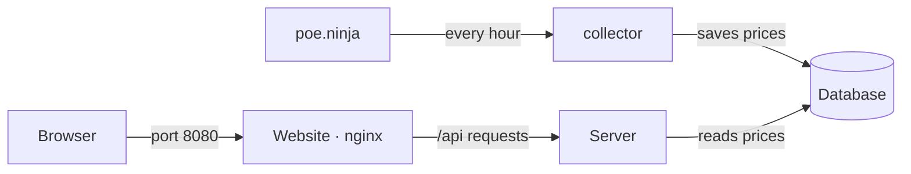

# PoE2 Farm Tracker

A tool for Path of Exile 2 players: track your farming runs, record the loot, and see how much each run earns per hour.

I started it as a simple React website with price files built into the app. Now prices are collected automatically: a small program downloads them from poe.ninja every hour and saves them in a database, a server gives them to the website, and everything starts with one command (`docker compose up`).

## Status

| Part | Status |
| --- | --- |
| Website: farming sessions, runs, loot value | ✅ works ([known issues](#known-issues)) |
| Collector: downloads prices from poe.ninja every hour | ✅ done |
| Database: stores all prices and their history | ✅ done |
| Server (API): gives the latest prices to the website | ✅ done |
| Everything runs in Docker with one command | ✅ done |
| Put it online on my own server (VPS) | 🔄 next |

## Live demo

[Open PoE2 Farm Tracker](https://lysar.poe2tracker.workers.dev/)

The demo shows the website only. Prices there are a saved copy, not live. The collector, database, and server are not online yet — that is the next step.

You don't need an account. Your data is saved in your browser.

## How it works



The project has four parts. Each one runs in its own Docker container:

| Part | What it does |
| --- | --- |
| **collector** | Every hour downloads prices from poe.ninja and saves them in the database. |
| **db** | PostgreSQL database. Keeps the list of items and every price ever collected. |
| **api** | Express server. When the website asks for prices, it reads the newest ones from the database. |
| **web** | nginx. Gives the website to the browser and passes price requests on to the server. |

Only **web** can be reached from outside (port 8080). The database and the server are hidden inside Docker and can only talk to each other.

## Why it is built this way

- **The collector and the server are separate.** If poe.ninja is down, the website still works and shows the last saved prices.
- **Each price update is saved all at once.** If something fails in the middle, nothing is saved, so the database never has half an update.
- **Only one door is open.** Users can only reach nginx. The database and the server are not reachable from the internet, which makes the project safer.
- **Services start in the right order.** Docker first waits until the database is really ready, then starts the server and the collector, and only then the website.
- **Settings and passwords are kept outside the code**, in a `.env` file that is never uploaded to GitHub. The file `.env.example` shows which settings are needed.

## Run it on your computer

You need Docker Desktop.

1. Copy the settings file:

   ```
   copy .env.example .env
   ```

2. Open `.env` and fill in:

   | Setting | Meaning |
   | --- | --- |
   | `DB_PASSWORD` | any password for the database (letters and numbers only) |
   | `LEAGUE` | the league name on poe.ninja, for example `Forbidden Rites` |
   | `USER_AGENT` | a name and a contact, so poe.ninja knows who is downloading their data |

3. Start everything:

   ```
   docker compose up --build
   ```

4. Open **http://localhost:8080**. The first prices appear after about 20 seconds.

Useful commands:

| Command | What it does |
| --- | --- |
| `docker compose ps` | shows which parts are running |
| `docker compose logs -f collector` | shows what the collector is doing |
| `docker compose down` | stops everything (the saved prices stay) |
| `docker compose down -v` | stops everything and deletes the database |

### Server endpoints

| Address | Answer |
| --- | --- |
| `/health` | is the server running and can it reach the database |
| `/api/prices` | the newest price of every item |

## Data

- Prices come from the [poe.ninja API](https://poe.ninja/docs/api). poe.ninja updates PoE 2 prices about once an hour, so the collector also asks only once an hour and waits between requests.
- The database has two tables: **items** (name, category, picture) and **prices** (item, league, price, time). Every hour adds new rows to **prices**, so the history is kept.
- Your farming sessions are saved in the browser (localStorage). They are not synced between devices yet.

## Known issues

- **No drag preview for Waystone items.** When you drag an item from the Waystone group, the styled preview card is not shown.

## Problems I solved

| What went wrong | Why | How I fixed it |
| --- | --- | --- |
| The database created only one of two tables | a mistake in the table setup; the setup script stops at the first error and runs only once | found the error in the Docker logs, fixed the script, created the database again |
| The collector saved items but no prices, and showed no error | for most categories I read the item ID from the wrong field, so no price matched an item | added a log line with saved/skipped counts and used the right field |
| Every price was saved twice | two copies of the collector were running at the same time | found and stopped the second one |
| Docker couldn't read `compose.yaml` | one line had 4 spaces instead of 2, and in YAML spaces decide what belongs where | fixed the spaces |
| The website built on Windows but not in Docker | Linux treats `Main.jsx` and `main.jsx` as different files, Windows doesn't | made the file name match everywhere |

## What I'm learning next

This project is how I learn infrastructure step by step. Next:

- **Linux basics** — working in the terminal, files and permissions, users, processes, logs.
- **SQL** — writing queries myself: joins, grouping, indexes, and reading price history from the database.
- **Docker in more depth** — reading the official documentation instead of only following examples.
- **nginx** — how it serves files and forwards requests, and how to set up HTTPS.
- **Running a server** — SSH, firewall, and backups, so I can put this project online on a VPS.

## Plans

1. **Go online** — rent a server (VPS), secure it, add a domain with HTTPS, set up automatic backups and automatic deploys from GitHub.
2. **Website** — save run presets, fix the Waystone drag preview.
3. **Accounts** — log in with Discord or Google, so your data is not tied to one browser.
4. **Later** — save sessions in the database, price charts (only if poe.ninja is fine with it).

## Built with

React, TypeScript, Vite · Node.js, Express · PostgreSQL · Docker, nginx · poe.ninja API
